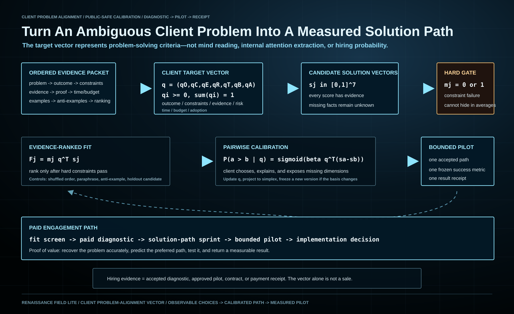

# Client Problem-Alignment Vector Protocol

Date: `2026-11-01`

Status: `public-safe draft / local review / not yet published`



## Purpose

This protocol converts a client's stated problem, constraints, preferences,
and observed choices into an external, auditable target vector for solution
selection.

It does not claim to extract a private transformer attention vector, read a
client's mind, or produce exact alignment from one conversation. The vector is
an engagement-specific measurement object that is estimated, tested, updated,
and tied to a real pilot outcome.

The target vector is not the probability that a client will hire Renaissance
Field Lite. It represents the client's relative problem-solving criteria.
Hiring confidence requires separate pipeline evidence such as an accepted
diagnostic, approved pilot, contract, or payment receipt.

The operating relation is:

```text
Source Mirror Pattern / Universal Data Pattern
-> cohesive ordered client evidence
-> transformer probability-conditioned processing
-> candidate solution paths
-> explicit client target vector and hard constraints
-> pairwise calibration
-> selected pilot
-> measured outcome and vector update
```

## 1. Ordered Client Evidence Packet

The intake sequence is fixed before candidate generation:

1. current problem and affected system;
2. desired outcome and decision to be enabled;
3. hard constraints and prohibited outcomes;
4. available evidence, systems, people, and resources;
5. required proof or acceptance standard;
6. time and budget boundary;
7. positive examples and anti-examples;
8. initial ranking of candidate approaches.

The order is part of the measurement. A shuffled-order control tests whether a
recommendation is stable or depends on accidental presentation order.

## 2. Client Target Vector

Define a versioned basis with seven public-safe dimensions:

\[
q=(q_O,q_C,q_E,q_R,q_T,q_B,q_A),
\qquad q_i\ge 0,\qquad \sum_i q_i=1.
\]

| Dimension | Meaning |
| --- | --- |
| \(O\) | desired outcome and material impact |
| \(C\) | constraints, compliance, and prohibited outcomes |
| \(E\) | evidence and verification threshold |
| \(R\) | acceptable technical and operational risk |
| \(T\) | time, urgency, and sequencing |
| \(B\) | budget, people, compute, and resource fit |
| \(A\) | adoption, communication, and workflow fit |

The initial weights come from the ordered intake and are normalized:

\[
q_i^{(0)}=\frac{w_i}{\sum_k w_k}.
\]

Domain-specific dimensions may be added, but the basis and version must be
frozen before comparing candidate solutions.

## 3. Candidate Solution Vectors

For candidate solution path \(j\), record an evidence-backed score vector

\[
s_j=(s_{jO},s_{jC},s_{jE},s_{jR},s_{jT},s_{jB},s_{jA}),
\qquad 0\le s_{ji}\le1.
\]

Every score requires a source, assumption, test, or explicit `unknown`. A
missing fact is not silently converted into a favorable score.

Hard requirements are represented separately. Let \(H\) be the set of hard
dimensions and \(\tau_i\) their minimum acceptable values:

\[
m_j=\prod_{i\in H}\mathbf 1[s_{ji}\ge\tau_i].
\]

The initial fit score is

\[
F_j=m_j\,q^{\mathsf T}s_j.
\]

This prevents a high average score from hiding a failed compliance, safety,
budget, or delivery requirement.

## 4. Pairwise Calibration

The client is shown bounded pairs of materially different solution paths. For
two candidates \(a\) and \(b\), the predicted preference is

\[
P(a\succ b\mid q)=
\sigma\!\left(\beta\,q^{\mathsf T}(s_a-s_b)\right),
\]

where \(\sigma\) is the logistic function and \(\beta\) is a calibrated
sensitivity parameter.

After the client selects one path and explains the reason, update the target
vector and project it back onto the probability simplex:

\[
q^{(t+1)}=
\Pi_{\Delta}\!\left[
q^{(t)}+\eta\,(y-\hat y)(s_a-s_b)
\right].
\]

Here \(y\) is the observed preference, \(\hat y\) is the predicted preference,
\(\eta\) is the predeclared update rate, and \(\Pi_{\Delta}\) preserves
nonnegative weights that sum to one.

The explanation is retained as evidence. It may reveal a missing dimension or
hard constraint; if the basis changes, the protocol starts a new version rather
than silently rewriting the old vector.

## 5. Calibration And Stop Gate

The vector is ready to guide a paid pilot only when:

1. hard constraints are explicit and acknowledged;
2. held-out pairwise choices are predicted above a predeclared engagement
   threshold;
3. the target vector remains within a predeclared drift tolerance across the
   final calibration round;
4. the client confirms that the top-ranked path reflects the intended outcome;
5. one small pilot can test the claimed value with a real acceptance metric.

No universal accuracy or drift threshold is asserted here. Each engagement
sets those gates before scoring so they cannot be moved after seeing results.

## 6. Controls

The minimum control pack is:

- shuffled intake order;
- paraphrased problem statement;
- positive and anti-example holdouts;
- one candidate that satisfies surface language but violates a hard constraint;
- one evidence-strong candidate that differs from the client's initial idea;
- held-out pairwise comparisons;
- client confirmation before pilot;
- pilot outcome measured against the frozen acceptance metric.

These controls distinguish genuine problem alignment from tone matching,
generic agreement, or one persuasive answer.

## 7. Client Deliverables

A completed alignment diagnostic produces:

1. a versioned Client Problem State Card;
2. the ordered evidence packet;
3. the target-vector basis, weights, confidence notes, and hard constraints;
4. the candidate solution matrix with evidence and unknowns;
5. pairwise calibration and holdout receipts;
6. the selected pilot and acceptance metric;
7. an update record after the pilot.

The commercial value is not the vector by itself. The value is a repeatable
method that turns an ambiguous problem into an evidence-ranked solution path,
tests whether the ranking matches the client's actual decisions, and closes
with a measurable pilot result.

## 8. Engagement Path

The vector becomes commercially useful through a gated service path:

1. **Fit screen:** confirm that the problem, evidence access, authority, and
   budget lane are real enough for a diagnostic.
2. **Paid alignment diagnostic:** build the ordered evidence packet, target
   basis, initial vector, hard constraints, and calibration comparisons.
3. **Solution-path sprint:** produce materially different candidate paths,
   evidence-score them, and test whether the vector predicts the client's held-
   out choices.
4. **Bounded pilot:** execute the top accepted path against one frozen success
   metric.
5. **Implementation decision:** expand only after the pilot receipt establishes
   the promised value.

The hiring case is therefore not “trust our probability vector.” It is:

```text
we recovered the problem accurately
-> showed the alternatives and constraints
-> predicted the client's preferred path
-> tested that path in a bounded pilot
-> returned a measurable result
```

## 9. Evidence Boundary

This protocol measures alignment between a client's observable decisions and a
declared solution basis. It does not establish access to private thoughts,
extract proprietary transformer internals, guarantee that one vector remains
stable across contexts, or replace domain expertise and contractual acceptance
criteria.

The client vector is downstream of the cohesive evidence packet and separate
from the model's internal attention matrices. That separation keeps the method
auditable, portable across model providers, and usable when hidden states are
not available.
