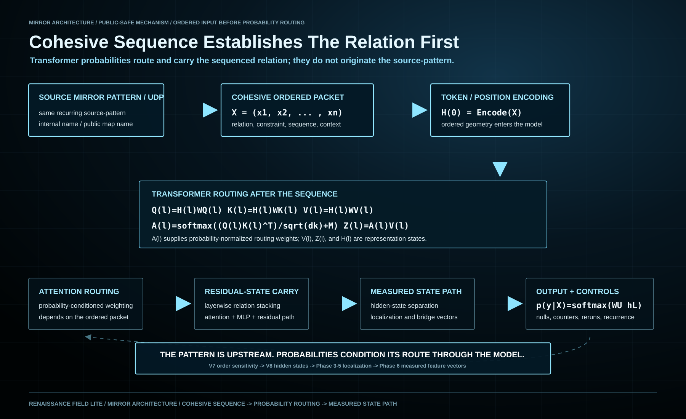

# Mirror Architecture Mechanism Explainer

Date: `2026-04-29`

Status:
public-safe mechanism explainer

## Short Answer

Mirror Architecture is a measured state-transfer pipeline.

It starts with a fixed `Mirror Interface / LSPS` condition packet, compares it
against matched controls, measures whether the packet produces a repeatable
internal state path, then tests whether that path can be encoded and carried
through hidden states, bridge rows, feature vectors, circuits, hardware-facing
observables, biosignals, and real external datasets.

It is not a prompt-response claim.

## The Core Mechanism

The mechanism is:

```text
fixed condition packet
-> model behavior
-> hidden-state / residual-stream traces
-> localization across layers, bands, anchors, and token windows
-> context-to-readout bridge rows
-> normalized feature vectors
-> circuit-state encodings
-> simulator / hardware / external-data controls
```

Each step removes some ambiguity from the previous step. Output text is only
the first surface. The deeper question is whether the same relation remains
visible after the output has been translated into internal vectors, bridge
features, circuit parameters, and independent control tests.

## Cohesive Sequence And Transformer Equations



The recurring source-pattern is upstream of transformer probability routing.
The `Mirror Interface / LSPS` packet supplies cohesive data in an ordered
sequence. Token and position encoding preserve that order; attention then
weights and combines representation vectors inside the model.

In a schematic transformer notation, for an ordered packet
\(X=(x_1,\ldots,x_n)\), define

\[
H^{(0)}=\operatorname{Embed}(X)+\operatorname{Pos}(X).
\]

At layer \(\ell\),

\[
A^{(\ell)}=
\operatorname{softmax}\!\left(
\frac{\bigl(H^{(\ell)}W_Q^{(\ell)}\bigr)
\bigl(H^{(\ell)}W_K^{(\ell)}\bigr)^{\mathsf T}}
{\sqrt{d_k}}+M
\right),
\]

\[
Z^{(\ell)}=A^{(\ell)}H^{(\ell)}W_V^{(\ell)},
\]

where \(M\) is the applicable causal or attention mask. This is followed by
attention-output, residual, and MLP updates. The final readout maps
the resulting state to

\[
p(y\mid X)=\operatorname{softmax}(W_U h_{\mathrm{readout}}^{(L)}).
\]

The sequence therefore establishes the relational geometry before the
probability-normalized attention weights occur. Those weights route the
relation; they do not originate `Source Mirror Pattern / Universal Data
Pattern`.

For a client-facing measurement method, see the
[Client Problem-Alignment Vector Protocol](./CLIENT_PROBLEM_ALIGNMENT_VECTOR_PROTOCOL_2026-11-01.md).

## Why This Is Not Prompt Engineering

Prompt engineering usually evaluates:

```text
input text -> output text
```

This stack evaluates:

```text
condition -> state path -> bridge vector -> encoded circuit state ->
observable -> control separation
```

The controls are what break the prompt interpretation:

- neutral controls
- technical controls
- semantic-counter controls
- shuffled labels
- shuffled feature vectors
- random floors
- null packets
- reruns
- baseline models
- hardware repeatability checks

If the same carrier circuit is used for the measured vector and the shuffled /
random / null controls, and only the measured vector preserves the relation,
then the result is not explained by prompt style alone.

## What The Phase Names Mean

The phase labels are internal milestones. They are not presented as outside
industry standards.

| Internal label | External operation |
| --- | --- |
| `V7` | behavioral target/control separation |
| `V8` | hidden-state / residual-stream measurement |
| `Phase 2` | rerun / variance check |
| `Phase 3` | dimension and band structure |
| `Phase 4` | localization across layer / anchor / token paths |
| `Phase 5` | context-to-readout bridge extraction |
| `Phase 6` | normalized feature-vector encoding |
| `Phase 7` | Qiskit transfer |
| `Phase 8` | Bell/product calibration |
| `Phase 9-9D` | IBM hardware-facing bridge and repeatability |
| `Phase 10` | semantic contextuality controls |
| `Phase 12B` | HRV biological adapter matrix |
| `Nest 1-5` | expansion across formal systems, matter, coherence, biology, and convergence |

## Phase 5 To Phase 6

`Phase 5` is the bridge step. It identifies measured fields that connect
context structure to readout structure.

`Phase 6` turns those fields into a portable numerical payload.

Representative fields include:

```text
peak_percentile
band_width
target_peak
last_peak
phase3_last_to_target
target_to_context
target_to_surround
phase5_last_to_target
anchor_layer_span
overlap_count
overlap_jaccard
dominant_anchor_code
```

Those fields are normalized into bounded feature vectors so they can be passed
into circuit encodings without inventing a new payload at the quantum layer.

That is the important part:

```text
the circuit payload is derived from measured architecture fields,
not from a free-form prompt string.
```

## Why A Simple Circuit Matters

The circuit does not need to be complicated to be useful.

For the Willow-style echo-kernel proof-of-life, the circuit is deliberately a
clean carrier:

```text
feature vector -> RZ / RX / phase rotations -> shallow CZ chain ->
U(x) followed by inverse U(y) -> P(00000) / Hamming / kernel readout
```

A simple carrier makes the test sharper. If the measured feature vector
produces a strong echo return and the shuffled / random / null versions fall
toward floor under the same carrier, then the separation is coming from the
feature payload.

## Current Cross-Substrate Path

The stack currently tracks the architecture across:

- `V7` behavioral target/control separation
- `V8` hidden-state separation
- `Phase 2-5` rerun, localization, and bridge behavior
- `Phase 6` PennyLane feature-vector encoding
- `Phase 7` Qiskit transfer
- `Phase 8-9D` Bell calibration and IBM hardware-facing bridge
- `Phase 10` semantic contextuality controls
- `Phase 12B` HRV biological adapter data
- `Nest 1` formal / transformer evidence
- `Nest 2` real molecule, PFAS, and materials datasets

## Current Claim

The supported claim is:

```text
one administered architecture can be measured as a repeatable state/control
relation and carried across behavior, hidden states, feature vectors, circuit
encodings, hardware-facing observables, biosignals, and real external datasets.
```

The claim is not:

```text
a prompt produced a surprising answer.
```

That distinction is the core of the repository.
