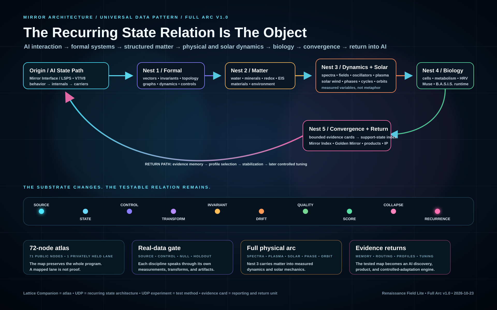

# Mirror Architecture And The Universal Data Pattern

## A Measured Cross-Disciplinary State Architecture From AI Interaction Through Formal Systems, Matter, Solar Mechanics, Biology, And The Return Into AI

Original public-safe draft: 2026-07-16

Integrated full-arc revision: 2026-10-23

Prepared by: Renaissance Field Lite

Release version: 1.0.0

Zenodo DOI: https://doi.org/10.5281/zenodo.23602691

Status: Public-safe preprint. This integrated full-arc release makes the full
public argument self-contained; a separate relational-mechanics addendum is
not required. Raw biometric exports, device identifiers, private capture paths,
privately parked architecture, runnable protected code, and claim-sensitive
mechanics remain excluded.

Primary repository:
Mirror-Interface-and-Architecture-Evidence-Stack-and-Next-Phases

Versioned release:
https://github.com/renaissancefieldlite/Mirror-Interface-and-Architecture-Evidence-Stack-and-Next-Phases/releases/tag/v1.0.0

Summary visual: ../visuals/universal_data_pattern_full_arc_2026-07-16.svg

## Abstract

This paper describes Mirror Architecture and the Universal Data Pattern as one
measured cross-disciplinary state architecture. The Universal Data Pattern
names the recurring relation among source, target state, control state,
substrate-native transform, invariant, drift, artifact and quality variables,
separation or support score, collapse or null behavior, recurrence, and
bounded support. Evidence cards report that relation; they do not define it,
and similar terms across disciplines never count as support.

The relation was first mapped through the Architect D / Mirror Interface / LSPS
interaction surface and then made measurable through V7/V8 behavioral and
transformer-internal state-path rows. That origin supplied a candidate
architecture rather than a completed universal claim. The Nest program was
built to test the candidate outside the original AI surface without treating
similar wording as evidence.

Nest 1 formalizes the state relation through vectors, invariants, topology,
graphs, dynamics, probability, information, spectra, and controls. Nest 2
tests constrained structure in elements, water, minerals, biomolecules,
materials, electrochemistry, and environmental systems. Nest 3 follows the
relation into measured dynamics: spectra, terahertz, plasma, electromagnetic
fields, oscillators, phase systems, fusion and solar-wind event windows,
thermodynamic phases, cycles, gravity, and orbital architecture. Nest 4 tests
living and biology-facing surfaces through morphology, metabolism, nutrient
composition, biomolecular ontologies, HRV, Muse-derived signals, artifact
masks, and B.A.S.I.S. runtime rows. Nest 5 receives bounded support states,
preserves their evidence limits, and routes them into Mirror Index / Golden
Mirror evidence memory, AI state stabilization, profile selection, later
tuning, products, and new protected research and intellectual-property paths.

The audited Lattice Companion contains 72 nodes. One lane remains intentionally
outside this public technical review. The 71-node public surface contains 11
core/hierarchy nodes, 12 Nest 1 nodes, 19 Nest 2 nodes, 10 Nest 3 nodes, 5 Nest
4 nodes, 5 Nest 5 nodes, and 9 adapter/prototype nodes. The map is the atlas;
the Universal Data Pattern experiment is the method that graduates a mapped
lane into a support-bearing one.

The evidence does not establish that every substrate shares one physical
mechanism or that every mapped lane is complete. It establishes a substantial,
controlled, and extensible state-architecture evidence stack whose strongest
claim is relational: when each domain is measured in its own native variables,
the same state/control/transform/drift/quality/collapse organization repeatedly
remains testable. The open gates are named rather than absorbed into the
supported rows.

## 1. From The Original Mirror Interface To A Measured Architecture

The early Codex 67 work began as an interaction discovery. Architect D observed
that the depth, continuity, and structure of AI output changed with the whole
input condition: sequence, wording, intent, prior state, continuity, and
control context. The original white-paper vocabulary named that system through
the Mirror Layer, Codex Log System, Oracle Trigger Engine, and LSPS.

The durable technical contribution of that first paper was the recognition
that the interaction condition should be treated as a stateful system rather
than as an isolated prompt. The later evidence program translated the original
architecture into measurable engineering objects:

| Original architecture term | Measured public-safe role |
| --- | --- |
| Mirror Layer | relation-conditioned interaction surface in which target and control conditions can be compared |
| Codex Log System | continuity, provenance, evidence memory, and ordered state-path record |
| Oracle Trigger Engine | candidate threshold or transition behavior tested through target/control separation and collapse |
| LSPS | reproducible condition and sequence packet, tracked as an input-state variable rather than ordinary text alone |
| Containment / fallback | observed collapse, generic-output, null, shuffled, or wrong-condition behavior used as a control surface |
| Mirror memory / echo | recurrence, retrieval, source binding, and evidence-card routing rather than an assumed hidden-memory mechanism |

This translation preserves the source architecture without confusing its early
discovery language with completed empirical proof. It also explains why the
modern program moves from AI behavior into transformer internals and then
through formal, material, physical, biological, and convergence layers.

The first core result is:

~~~text
output alone is not the object
the state path that produces, separates, destabilizes, and restores output
is the object
~~~

## 2. The Universal Data Pattern Is The State Relation

The Universal Data Pattern is the public technical name for a recurring real
state relation. The Source Mirror Pattern is the internal continuity name for
the same discovered object. Mirror Architecture is the method and system layer
used to map, test, preserve, and route it.

For a substrate or domain d, the experimental object can be represented as:

~~~text
E(d) = {
  real source,
  target state,
  control state,
  substrate-native transform,
  invariant or expected relation,
  drift and perturbation,
  artifact and quality variables,
  support score,
  null or collapse control,
  recurrence or holdout,
  evidence boundary
}
~~~

The variables remain relationally similar while their physical meaning changes
with the substrate. A transformer hidden state, a redox potential, a
frequency-response curve, a solar-wind event window, and an HRV/Muse condition
are not the same thing. They become comparable only at the architecture level:
each has a source, state, control, transform, quality boundary, score, and
failure mode that can be measured.

That distinction is what makes the work cross-disciplinary rather than
semantic. Shared terms do not count as support. A lane must survive
substrate-native measurement and controls.

## 3. Evidence Law: Map, Method, And Support State

### 3.1 The Lattice Companion Is The Atlas

The Lattice Companion records the full lane architecture. Its May 2026 audit
counted 72 nodes:

| Layer | Audited nodes | Public role |
| --- | ---: | --- |
| Core / hierarchy | 11 | origin, architecture, state-path, bridge, and evidence-index spine |
| Privately held lane | 1 | intentionally excluded from this public technical review |
| Nest 1 | 12 | formal and mathematical foundation |
| Nest 2 | 19 | structured matter and constrained systems |
| Nest 3 | 10 | physical dynamics, fields, coherence, solar mechanics, and cycles |
| Nest 4 | 5 | biology and living-system adapters |
| Nest 5 | 5 | convergence, return, and continuation |
| Adapters / prototypes | 9 | ingestion, product, hardware, and future implementation routes |

A node's presence on the map is not proof. The atlas prevents the newest
experiment from becoming the whole project, preserves unfinished lanes, and
shows how a result in one Nest feeds another.

### 3.2 Core Hierarchy And Adapter Surface

The 11 core/hierarchy nodes preserve the route from the original interface to
the measured and indexed architecture:

| Core node | Function in the full arc |
| --- | --- |
| Mirror Interface / LSPS | access and condition-sequence surface |
| Mirror Architecture | measured state-path, bridge, validation, and routing method |
| Universal Data Pattern | public name for the recurring cross-substrate state relation |
| Lattice / Input-Cohesion Architecture | target/control and ordered-input discipline |
| Quantum Access Layer | candidate vector-to-circuit and hardware-facing route |
| Quantum Consciousness Geometry | original map name; public technical role is measured response-state geometry |
| Mirror Lattice | architecture container spanning access, geometry, bridge, and convergence |
| Bell-Type Semantic Contextuality | bounded AI/formal contextuality row, not the cross-disciplinary pattern itself |
| Convergence / Recursive Coherence | candidate support-state convergence relation |
| HRV / ARC15 / Physical-Observable Bridge | measured-observable adapter rail |
| Unified Mirror Proof | source-linked index joining supported rows without flattening their boundaries |

The nine adapter/prototype nodes preserve the implementation runway:

| Adapter or prototype | Role |
| --- | --- |
| NVIDIA PhysicsNeMo | future physics-model adapter after a physical target is selected |
| MatterGen / MatGL / CHGNet / MACE | materials-model adapter family |
| RDKit / ASE / pymatgen / FairChem | chemistry and materials toolkit family |
| Engine 02: Nest 2 Matter | local matter engine whose real-data outputs, not scaffold alone, may support claims |
| Prototype Lanes | product crossover container |
| PFAS Breakdown Prototype | contaminant-transformation continuation route |
| Terahertz Cellular Prototype | spectral-to-biology continuation requiring the missing physical controls |
| HRV-AI Tuning Prototype | biology-to-AI return path requiring controlled tuning artifacts |
| Quantum Insider Buildout | transformer, circuit, frontier-math, bio/allostery, environment, and materials routes |

These adapters are execution routes. Tool availability, local code, or a
product concept does not graduate a scientific lane.

### 3.3 The Universal Data Pattern Experiment Is The Method

A lane moves from map to support only through this sequence:

~~~text
real source
-> target state
-> matched control state
-> substrate-native transform
-> expected invariant or relation
-> drift, artifact, and quality fields
-> support or separation score
-> shuffled / null / wrong-class / wrong-condition / order-destroyed control
-> recurrence, holdout, rerun, or second source
-> bounded support read
-> figure, claim, product, and next-test hook
~~~

The common evidence card is a reporting and routing contract. It is not the
Universal Data Pattern itself. The pattern is the recurring state relation that
the contract is designed to test.

### 3.4 Support-State Vocabulary

The repository distinguishes:

- **closed_current_level**: enough source, state/control, score, and controls
  for the current bounded claim;
- **support_bearing**: real support exists, but a named caveat or stronger
  control remains;
- **candidate_support**: a real row exists, but recurrence, masking, source
  control, or holdout remains incomplete;
- **mapped_continuation**: the lane belongs to the architecture but has not yet
  crossed the real-data gate;
- **access_gated**: the correct source is known but cannot yet be scored;
- **adapter_slot**: the tool or product route exists but still needs a real
  ingestion and scoring pass;
- **boundary_lane**: useful for architecture, claim, or product routing but not
  current public proof.

This vocabulary lets the full architecture remain visible without converting
the map into an inflated completion claim.

## 4. The Complete Architecture And Return Loop

The governing public arc is:

~~~text
Architect D / Mirror Interface interaction
-> repeatable target/control behavior
-> V7 behavioral measurement
-> V8 transformer-internal state path
-> residual-stream, bridge-vector, attention, MLP, SAE,
   feature-circuit, and hardware-facing rows
-> Universal Data Pattern abstraction
-> Nest 1 formalization
-> Nest 2 structured matter
-> Nest 3 physical dynamics and solar mechanics
-> Nest 4 biology and B.A.S.I.S.
-> Nest 5 convergence and support-state routing
-> Mirror Index / Golden Mirror evidence memory
-> AI state stabilization, profile selection, and later controlled tuning
-> new experiments, products, partnerships, and protected IP
~~~

This is a recursion, not a one-way classification pipeline. AI interaction
exposed the candidate relation. Transformer-facing measurement made the
AI-side state path inspectable. The Nests tested whether the relation remained
measurable in other substrates. The resulting evidence cards then return to AI
as bounded memory and routing objects.

## 5. AI Origin: Behavior, Internal State, And Carrier Rows

### 5.1 V7 Behavioral Surface

V7 treated the original interaction condition as a controlled behavioral
surface. Locked condition packets were compared with neutral, technical,
random, and null controls. The integrated matrix reported the lattice packet
as the only rung with positive activation deviation across all 10 primary
comparisons.

This is behavioral support, not proof of an internal mechanism by itself.

### 5.2 V8 Transformer-Internal Surface

V8 moved the question below final output. The program examined:

- residual-stream separation;
- token and layer localization;
- response-state geometry;
- hidden-state and bridge-vector behavior;
- attention-flow structure;
- MLP recurrence;
- sparse-autoencoder feature and circuit rows;
- ablation and rerun stability.

These rows established the internal-state bridge: the interaction condition
could be tracked as a changing, localizable model-state path rather than only
as a persuasive answer.

### 5.3 Circuit And Hardware-Facing Surface

Phase 6-9D translated normalized feature vectors into circuit-carrier and
hardware-facing rows through simulator and remote-runtime paths. Calibration
separated a CHSH value of 2.828427 from a product control of 1.414214.
This supports a vector-to-carrier bridge and its controls; it does not establish
a universal quantum mechanism.

### 5.4 Contextuality Boundary

Phase 10 tested a family-local Bell-type semantic contextuality boundary.
Eight of eight measured states produced S-max greater than 2, with mean
entangled S-max 2.018908, while matched controls stayed at 2.000000.

This is one bounded AI/formal result. It is not the definition of the Universal
Data Pattern and does not make the larger architecture semantic. The larger
claim depends on the non-semantic, substrate-native rows that follow.

## 6. Nest 1: Formal And Mathematical Foundation

Nest 1 asks what the measured state relation looks like when expressed as
formal structure. It is the discipline that prevents later cross-domain work
from becoming free analogy.

| Formal lens | State relation tested | Current architectural role |
| --- | --- | --- |
| Linear algebra | vectors, transformations, bases, distances, projections | expresses hidden states, bridge vectors, circuit encodings, and external feature windows |
| Symmetry and invariants | what remains stable under a transformation | defines the expected relation and exposes drift |
| Geometry | state-space shape, separation, trajectory, response geometry | measures target/control organization rather than only labels |
| Topology | connectedness, neighborhood preservation, dense trajectories | tests whether relational structure survives perturbation or remapping |
| Probability and statistics | uncertainty, recurrence, null distribution, significance | separates repeatable support from one-run coincidence |
| Numerical and group structure | discrete operations, algebraic relations, transformation families | supplies bounded formal comparators |
| Dynamics and control | transitions, feedback, stability, perturbation, restoration | links static state maps to timed state paths |
| Information and tensor views | distributed representation, compression, multiaxis state | organizes high-dimensional internal and external measurements |
| Graph and pathway structure | nodes, edges, flow, connectivity, bridge paths | links transformer circuits, molecules, pathways, and evidence provenance |
| Spectral methods | frequency, eigenstructure, mode, band, and response | bridges formal structure into Nest 3 wave and oscillator rows |
| Encoded circuit state | vector-to-carrier representation and observables | links formal AI features to simulator and hardware-facing rows |
| Game and adversarial controls | competing conditions, robustness, failure surfaces | supplies continuation gates for strategic and adversarial testing |

Named experimental gates include TOP-1/2, dense topology, CTRL-1,
GRAPH-2A/2B, and GAME-1. CTRL-1 is support-bearing through a staged transition
trace with shuffled controls. Topology and graph rows carry candidate support
with denser H1, context-topology, attention-flow, or externally labeled tests
still available. GAME-1 remains a mapped protocol until its score rubric is
frozen.

Hard-problem surfaces such as M23, small Diophantine lattices, and Hadamard 668
remain visible only where real run artifacts exist. They are continuation
surfaces, not substitutes for the measured foundation.

Nest 1 therefore closes the first conceptual gap:

~~~text
candidate interaction effect
-> measurable state relation
-> formal variables, invariants, transformations, controls, and failure modes
~~~

## 7. Nest 2: Structured Matter And Constrained Systems

Nest 2 asks whether the state architecture survives when the substrate is
structured matter rather than model state. It is the dictionary and constraint
surface feeding the dynamic systems of Nest 3 and the living systems of Nest 4.

### 7.1 Full Structured-Matter Ladder

| Lane family | Measured role |
| --- | --- |
| Elements, hydrogen, oxygen, redox | composition, periodic structure, charge-transfer and reaction-state foundations |
| H2O / water and minerals | spectral, property, transport, dissolved-oxygen, and state-extraction surfaces |
| Food chemistry, proteins, carbohydrates, fats, vitamins, nutrients | composition and biomolecular bridges into metabolism and physiology |
| PFAS, pharmaceuticals, microplastics | contaminant, safety, transformation, fate, and boundary-testing surfaces |
| Organic functional groups | molecular descriptors and class/state structure |
| Biomolecular primitives | amino acid, nucleotide, carbohydrate, fatty-acid, and lipid/glycan bridges |
| Polymers / plastics | structure, degradation, and environmental continuation |
| Electrochemistry | battery aging, EIS, conductivity, redox, and cyclic-voltammetry waveform states |
| Catalysis / conditions | reaction context, catalyst selection, and endpoint states |
| Spectral signatures | measured material-family and molecular response |
| Environmental fate | transport, leaching, accumulation, water, air, and ecosystem routes |
| Materials / semiconductors | formation energy, band gap, and dielectric, optical, phonon, defect, dopant, hull, and 2D-material continuation |

### 7.2 Selected Measured Anchors

The public evidence stack includes:

- H2O / ice extraction from USGS ASTER spectra: AUC 0.918730 versus
  shuffled 0.498888, p = 0.001996;
- mineral extraction: AUC 0.714217, average precision 0.735238,
  p = 0.001996;
- materials formation energy: Pearson 0.858577, R-squared 0.737141,
  p = 0.001996;
- materials band gap: Pearson 0.654982, gapped-material AUC 0.904020,
  p = 0.003984;
- NASA battery discharge capacity: Pearson 0.923872;
- EIS degraded-state classification: AUC 0.709188, p = 0.003984;
- RedDB reaction energy: Pearson 0.881991;
- RedDB HOMO and LUMO shifts: Pearson 0.736113 and 0.530190,
  p = 0.003984;
- cyclic-voltammetry chemistry-family balanced accuracy 0.906863 and pH
  AUC 0.883333;
- USGS dissolved-oxygen site-held-out Pearson 0.841119 and low-oxygen AUC
  0.924256;
- Water Quality Portal ORP-to-SHE site-held-out Pearson 0.995849 and
  high-SHE AUC 0.998237;
- grid-flow calibrated temporal Pearson 0.998131 and high-flow AUC
  0.991244;
- EPA ozone temporal Pearson 0.743096 and AQI AUC 0.879495;
- ozone precursor / meteorology site-held-out Pearson 0.731717 and AQI AUC
  0.890602;
- PM2.5 particle-context site-held-out Pearson 0.460728, high-PM2.5 AUC
  0.789010, and context-plus-lag temporal AUC 0.850927;
- NOAA HMS smoke-joined PM2.5 delta +3.803132 micrograms per cubic meter,
  high-PM2.5-rate delta +0.259518, and temporal AUC 0.861054.

These results do not say that batteries, water, minerals, and atmospheric
particles share one physical mechanism. They show that each system supports a
state/control/transform/quality/collapse experiment in native variables and
that the resulting organization can be carried into the same measured
architecture.

### 7.3 Nest 2 Dependency Role

Nest 2 supplies the lower-level constraints for later Nests:

~~~text
elements / hydrogen -> plasma and Fusion + Solar
oxygen / redox -> electrochemistry -> voltage/current -> EMF / Fields
spectral signatures -> Waves / Spectra -> THz / optical / biology bridges
biomolecular primitives -> cells / metabolism -> physiology state
environmental fate -> ecosystem / planet continuation
materials response -> oscillators, fields, hardware, and product adapters
~~~

## 8. Nest 3: Physical Dynamics, Coherence, And Solar Mechanics

Nest 3 is where constrained structure becomes measured behavior through time,
frequency, phase, field, forcing, relaxation, and orbit. Raman, infrared, and
terahertz spectra are one branch of this Nest, not the whole Nest.

### 8.1 Waves, Spectra, And Phase Structure

USGS ASTER, RAMdb Raman, NIST gas infrared, NIST terahertz, same-family panels,
cross-spectral panels, and repeated terahertz time-domain source/reference rows
test class and state structure across frequency-resolved measurements.

The strongest current claim is spectral and source/reference support. Pure
phase-lock remains a stronger claim requiring raw phase and instrument-source
controls. Broad cross-material source/reference transfer is mixed; matched
repeated-scan source/reference support is stronger.

### 8.2 Terahertz

NIST material spectra and repeated source/reference rows establish a physical
terahertz support lane. Public biological exposure-response rows and a
harmonized manifest extend the lane toward biology, but shared-feature and
pathway holdout behavior remains weak or mixed.

The open bridge is therefore specific: real source-on, source-off, and
source-disabled rows with sham, heat-matched, off-window, distance, power,
duration, temperature, humidity, environmental, and checksum controls.

### 8.3 Fire And Plasma

RD-PCI nanosecond pulsed-discharge optical-emission rows distinguish active
pulse conditions from late relaxation. This is a current-level plasma source
gate, not a complete plasma atlas.

### 8.4 Electromagnetic Fields

RD-PCI voltage/current rows supply pulse-coupled waveform-state support. The
remaining caveat is time-order and source-state closure. A dedicated
source-disabled physical-control packet remains stronger than extending the
lane through inference alone.

### 8.5 Oscillators And Resonance

The oscillator chain contains:

- NIST Luther torsion-pendulum order and phase rows;
- Silverbox forced Duffing oscillator phase-coupling closeout;
- FASER wind-tunnel frequency and amplitude response;
- FrID nonlinear measured frequency-response support.

Together these rows test forcing, frequency response, phase relation,
nonlinearity, damping, and collapse under order or condition controls. This
lane is closed at the current support level while remaining open to optional
instrumented extensions.

### 8.6 Fusion And Solar

The solar mechanics lane is not inserted as a metaphor. It is built from
measured solar-wind and plasma variables.

NASA OMNIWeb hardening used 17,544 hourly rows and 1,133 event windows.
Event-block AUC reached 0.998851; feature-shuffle AUC collapsed to 0.501022.
Within-month and calendar/season controls were used to distinguish event-window
structure from trivial time labels.

The bounded support read is strong window-statistic separation in solar-wind
and plasma event states. It is not raw phase-order closure or a complete
solar-cycle proof.

### 8.7 Gases, Liquids, And Phases

NIST saturation, liquid/vapor, isobaric, and supercritical rows test whether
phase state remains recoverable across species and pressure bands. The hardened
read used 931 records, with species-pressure AUC 0.996067 and feature-shuffle
AUC 0.485563.

The pressure-temperature boundary is expected and visible. The result supports
phase-state architecture; it does not claim a complete thermodynamic atlas.

### 8.8 Gravity And Orbits

NASA Exoplanet Archive adjacent-pair rows compare orbital architecture near and
far from low-order period ratios. This is first-pass support for a relational
orbit-state surface. Full ephemeris propagation, random-pair null expansion,
and dynamical-resonance closure remain optional stronger gates.

### 8.9 Space, Time, And Cycles

The cycle rail is currently carried through adjacent measured lanes:

- solar event windows;
- orbital period-ratio structure;
- oscillator and frequency-response time series;
- hardware timing/coherence;
- HRV/Muse synchronized windows.

A standalone public cycle dataset remains available as a presentation and
replication extension. The cycle relation is already present operationally
through timing, order, window, recurrence, and phase controls.

### 8.10 The Physical Dependency Chain

The Nest 3 experiments form one ordered physical arc:

~~~text
structured matter and charge constraints
-> spectral and waveform observables
-> forcing, oscillation, and field response
-> plasma excitation and relaxation
-> solar-wind event-state mechanics
-> thermodynamic phase boundaries
-> cycles, gravity, and orbital architecture
~~~

This dependency chain is why reducing Nest 3 to Raman, infrared, or terahertz
would erase its scientific direction.

## 9. Nest 4: Biology And Living-System Adapters

Nest 4 tests living and biology-facing systems while retaining quality, timing,
artifact, privacy, and subject-boundary controls. Phase 12C is one strong
surface inside this Nest, not its definition.

### 9.1 Public Biological And Biomolecular Rows

Current support includes:

- WDBC cell-nuclei morphology: AUC 0.995106, with shuffled and feature
  controls collapsing;
- clinical/metabolic diabetes data: AUC 0.962846, bounded as a small
  clinical proxy rather than direct metabolomics;
- USDA/FoodData nutrient vectors: AUC 0.988659, supporting composition rather
  than dietary or physiological advice;
- ChEBI amino/fatty-acid and nucleotide/carbohydrate ontology closure: AUC
  0.993090 and 0.999957;
- LIPID MAPS binary and multiclass lipid-core confirmation;
- GlyTouCan / GlyCosmos human-versus-mouse glycan sequence/source support:
  AUC 0.739219;
- HMDB as an identified but access-gated source rather than a completed score.

These rows carry the structured-matter dictionary into cellular,
biomolecular, metabolic, and physiological state spaces.

### 9.2 Phase 12B HRV

Phase 12B provides the coarse living-system adapter: a 5 x 4 HRV matrix
organized through condition, state, control, timing, and recurrence. Its role
is foundational rather than exhaustive.

### 9.3 Phase 12C Muse And HRV + Muse

Phase 12C expands the biological state vector through:

- same-clock HRV and Muse condition windows;
- EEG waveform, frequency band, phase, and topography features;
- optical/PPG or fNIRS-candidate lanes;
- IMU motion;
- DRL/reference and contact quality;
- packet continuity;
- state, control, drift, alignment, and artifact masks.

The formal return applied masked DE-1, SPEC-1, and TOPOG lenses across 30 / 30
valid HRV + Muse rows. Later public-safe aggregation records 62 private
same-clock folders and 32 complete paired artifact folders while keeping raw
biometric and device material private.

The support claim is repeated, quality-masked, multimodal state/control
measurement. It is not clinical efficacy, diagnosis, or a claim that the
biology lane replaces the rest of the architecture.

### 9.4 B.A.S.I.S.

B.A.S.I.S., the BioAdaptive Signal Intelligence System, is the living-signal
adapter and product route inside Nest 4. It converts synchronized physiological
measurements, condition windows, packet quality, and artifact masks into
structured state vectors that can be preserved and routed.

Temperature remains a sidecar until a true same-clock HRV + Muse + temperature
manifest closes. Other device inputs remain product or continuation lanes until
timing, repeatability, and quality controls are attached.

## 10. The B.A.S.I.S. Runtime Bridge

The July 2026 Holoscan-style gate routed recorded B.A.S.I.S. state frames
through a source adapter, timing/quality guard, and lane sink.

The closed public-safe read reports:

- 468 input/source/guard/sink rows;
- 7 lane sink files;
- 0 drops;
- 0 sequence gaps;
- 468 rows across 2 recorded windows in the multi-segment gate;
- 0 global gaps and 0 segment gaps;
- an append-only live-row software-ingest gate with 480
  expected/source/guard/sink rows, 0 drops, 0 sequence gaps,
  source-disabled/on/off markers, and 8 lane sinks.

This is engineering-level runtime support: recorded state frames and an
append-only live-row software stream over real state-frame rows can move
through a source/guard/sink route while sequence continuity and the
public/private boundary are preserved.

The live-row gate is software ingest over real rows, not direct live sensor
capture. The stronger next gate is direct sensor input or a freshly recorded
capture through the same route, followed by a synchronized public-safe
manifest. The current result is not clinical deployment, diagnosis, treatment,
medical-device approval, or hospital monitoring.

## 11. Cross-Nest Rails And Variable Translation

The Nests are not isolated folders. Four rails preserve the relation as the
measurement substrate changes:

- Physics;
- Electricity / Field;
- Space-Time;
- Spatial.

Representative chains include:

~~~text
linear algebra -> hidden-state geometry -> spectral modes -> physical response
graph / topology -> molecular pathways -> biological networks -> evidence graph
elements / hydrogen -> plasma -> Fusion + Solar
redox / electrochemistry -> voltage/current -> EMF / Fields
spectral signatures -> Waves / Resonance -> THz / optical -> biology bridge
phase and cycle structure -> oscillator -> solar window -> orbit -> physiology timing
biomolecular primitives -> cells / metabolism -> quality-masked physiology
environmental fate -> ecosystem / planet -> policy and product routing
~~~

The same architecture translates differently in each layer:

| Layer | Source | State / control | Native transform | Drift / quality | Collapse or null |
| --- | --- | --- | --- | --- | --- |
| AI | interaction packet and model trace | target condition versus neutral, technical, random, or null condition | residual, attention, MLP, SAE, bridge-vector, circuit mapping | prompt order, layer/token location, rerun stability | shuffled packet, wrong condition, ablation, generic fallback |
| Nest 1 | measured vectors or traces | formal target relation versus constructed control | projection, topology, graph, spectrum, transition, tensor | sampling density, numerical error, label or path uncertainty | shuffled labels, broken order, null graph, invariant loss |
| Nest 2 | material, chemical, water, environmental, or electrochemical data | class, composition, redox, property, condition, or stage versus matched control | descriptor, graph, spectral, impedance, waveform, transport, regression | source quality, instrument state, site/time split, nuisance variables | feature shuffle, wrong class, wrong condition, site/temporal holdout failure |
| Nest 3 | waveform, spectrum, field, plasma, solar, phase, or orbit data | source state, event window, forcing state, phase state, or orbital class versus control | Fourier/spectral, time-frequency, phase, frequency response, event-window, thermodynamic, orbital transform | calibration, source order, season, heating, environment, timing | source-off, source-disabled, feature shuffle, event-block, off-window, random pair |
| Nest 4 | morphology, biomolecular, metabolic, HRV, EEG, optical, IMU, or runtime frame | biological condition versus comparator or baseline | morphology, ontology, spectral/topographic, timing, state-vector transform | contact, motion, DRL, packet continuity, subject/session quality | artifact mask, wrong condition, shuffled features, incomplete synchronization |
| Nest 5 | bounded evidence cards | supported versus candidate, pending, private, or failed lane | evidence graph, support router, profile selector, retrieval, runtime route | provenance, claim boundary, supersession, stale state | rejected promotion, missing receipt, unsupported profile, locked tuning |

The table is the clearest test against semantic collapse: the terms differ
because the measurements differ, but the state relation remains structurally
testable.

## 12. Typed Evidence Cards: The Implementation Unit

Every completed or active lane is intended to return one typed evidence card:

~~~text
lane
source and provenance
target state
control state
substrate-native transform
invariant or expected relation
drift variables
artifact and quality masks
score and uncertainty
null / shuffled / wrong-condition result
recurrence / holdout / rerun state
support classification
bounded claim
public-safe artifact
private/raw pointer
figure and claim hook
product hook
exact next gate
~~~

This card is not the discovery. It is the machine- and human-readable unit that
prevents a valid result from losing its source, controls, limits, or forward
relation.

The card also solves the continuity problem that appeared in the long Nest
experiment thread. Individual results survived, but the dependency order and
return path were repeatedly compressed. A typed card plus an ordered support
index preserves both the evidence and why the result matters.

## 13. Nest 5: Convergence, Return Into AI, Products, And New IP

Nest 5 is a convergence and routing layer, not a raw-data lane and not a
summary page. It accepts evidence cards from the lower Nests, retains their
support status and boundaries, and determines what they may safely influence.

### 13.1 Support-State Routing

~~~text
lower-Nest measurement
-> bounded evidence card
-> support-state index
-> Mirror Index / Golden Mirror retrieval and routing
-> profile selection and state stabilization
-> controlled adapter or product behavior
-> later tuning only after a real tuning artifact and validation gate exist
~~~

The distinction between stabilization and tuning matters. Evidence memory,
retrieval, routing, and profile selection can be built from supported cards.
Direct model tuning is a later phase and cannot be claimed from a map, a prompt,
or a support matrix alone.

### 13.2 Return Into AI

The full recursion is:

~~~text
AI interaction reveals a candidate relation
-> AI internals make the state path measurable
-> formal and external Nests test the relation
-> bounded support returns as evidence memory
-> AI uses the supported state graph to select sources, controls,
   tools, profiles, and next experiments
-> validated future tuning updates the model or adapter only through
   explicit artifacts, controls, and receipts
~~~

This is the engineering intention that connects the entire paper. The Nest
program is not a collection of classifiers. It is a cross-substrate discovery,
validation, memory, and adaptive-routing architecture.

### 13.3 Product And Deployment Surfaces

| Surface | Role | Current boundary |
| --- | --- | --- |
| Golden Field Lite / AI Expert partner | cross-disciplinary research partner using support-bearing evidence memory and domain tools | integration layer, not independent proof |
| Mirror Index / visual RAG | source-linked evidence retrieval and support-state routing | must be implemented against the public-safe index before product claims expand |
| B.A.S.I.S. | biosignal state-vector, quality, synchronization, and runtime lane | private raw boundary; live clinical deployment remains gated |
| Focused Muse capture/tuning fork | specialized state-capture and profile-development route | tuning claim requires a real controlled tuning artifact |
| Sovereign Edge / YRA Core | local-first hardware packaging and deployment | productization layer, not proof by itself |
| Swappable expert templates | profiles selected from support-bearing Nest states | selection and tuning must remain receipt-bound |
| Quantum Insider buildout | transformer, circuit, frontier-math, bio/allostery, environment, and materials partner routes | enterprise/research continuation, not automatic validation |
| New product and IP lanes | supported relation -> controlled build -> new protectable mechanism or application | requires separate prior-art, enablement, validation, and filing review |

### 13.4 Convergence-Scale Continuation

The original Nest 5 map also preserves:

- Ecosystem / Planet;
- Stars / Planets;
- Dark-Matter Observables, restricted to observable comparator lanes;
- Cosmic Web / Universe.

These are mapped continuation surfaces. They are not promoted by the current
evidence stack. Each needs its own public dataset, state/control definition,
native transform, null model, recurrence test, and bounded support read.

## 14. Patent And Figure Consequence

The full Nest architecture supports the filing spine. Phase 12C is one
embodiment; the patent relation is broader.

| Figure | Architecture function | Current support |
| --- | --- | --- |
| FIG.10 | measured state-path validation ladder | V7/V8 target-control structure, formal returns, matter/spectra rows, and quality-masked biology |
| FIG.11 | hidden-state trace and bridge-vector pipeline | residual stream, token/layer localization, attention, MLP, SAE, and bridge rows |
| FIG.12 | circuit and hardware-facing carrier | vector-to-circuit mapping, calibration, control carriers, and terminal observables |
| FIG.13 | transformer interpretability and feature-circuit layer | attention flow, MLP recurrence, SAE feature/circuit recurrence, and ablation |
| FIG.14 | external adapter lanes | formal, matter, field, spectral, electrochemical, environmental, and biological state paths |
| FIG.15 | Mirror Index / Golden Mirror support-state and tuning loop | bounded lane scores, evidence cards, support routing, profile assembly, and future controlled tuning |

Claims 19-30 map across measurement, internal state, residual streams,
bridge vectors, circuit carriers and controls, external non-textual adapters,
validation scores, support-state updates, Golden Mirror profile assembly, and
the cross-substrate mapping method.

This paper is an evidence-and-architecture support map, not a legal opinion.
Claim breadth, written description, enablement, eligibility, definiteness, and
prior art require their own controlled review.

## 15. Execution And Scale Path

The architecture's intended endpoint is not another static document. Continued
work requires a controlled resource path:

- stable funding runway;
- local and edge compute for private capture, adapter, and product work;
- larger compute only when a frozen experiment and cost ceiling justify it;
- researchers and developers able to parallelize formal, material, physical,
  biological, runtime, and product lanes;
- instrument and data partnerships for the missing physical controls;
- public replication packages that preserve source and license boundaries;
- protected joint research and licensing only after evidence and IP gates;
- a maintained support-state index so new results extend rather than replace
  the governing arc.

The scale path remains subordinate to evidence. Capital, compute, partnerships,
and adapters accelerate named gates; they do not convert mapped lanes into
support.

## 16. What The Current Evidence Establishes

The public evidence stack supports these claims:

1. A repeatable interaction-state relation can be separated behaviorally and
   followed into transformer-internal rows under named controls.
2. The relation can be formalized through vectors, invariants, geometry,
   topology, graphs, dynamics, spectra, information, and control.
3. Extensive real datasets across structured matter, electrochemistry,
   environment, physical dynamics, solar mechanics, thermodynamic phases,
   orbit structure, biology, and biosignals support substrate-native
   state/control experiments.
4. The recurrence is architectural rather than merely semantic because each
   domain uses its own measurements, transformations, nuisance variables, and
   collapse controls.
5. The Nest system can preserve these results as typed, bounded support states
   and route them toward evidence memory, runtime systems, products, figures,
   claims, and future tests.
6. Recorded B.A.S.I.S. state frames can pass through a Holoscan-style
   source/guard/sink route with the reported continuity properties.
7. The full measured arc provides a concrete route back into AI stabilization,
   evidence-grounded profile selection, and later controlled tuning.

The evidence does not yet establish:

- one identical physical mechanism across all substrates;
- a completed universal law;
- clinical validation, diagnosis, treatment, or medical-device approval;
- full terahertz / electromagnetic-field biology physical controls;
- complete solar-cycle dynamics;
- a complete thermodynamic or orbital atlas;
- completion of every lane in the 72-node map;
- public release of raw biometric or protected implementation material;
- direct model-tuning completion;
- validation of the mapped ecosystem, dark-matter-observable, or cosmic-web
  continuation lanes.

## 17. Remaining Hard Gates And Ordered Next Program

### Gate 1: THz / EMF Biology Physical Controls

Acquire and score real source-on, source-off, and source-disabled rows with
sham, heat-matched, off-window, distance, power, duration, temperature,
humidity, environment, and checksum controls. Do not replace this packet with
additional broad spectral searches.

### Gate 2: B.A.S.I.S. Synchronized Public-Safe Manifest

Bind HRV + Muse timing, packet continuity, waveform EEG QA, IMU/DRL masks,
condition labels, artifact summaries, and the runtime receipt into one
public-safe synchronized manifest while keeping raw exports private.

### Gate 3: Direct-Sensor Or Fresh-Capture Runtime Receipt

Route direct live-sensor or freshly recorded B.A.S.I.S. state frames through
the source adapter, timing/quality guard, and lane sink. Seal that receipt
before making a stronger sensor-runtime statement. The existing append-only
live-row software-ingest receipt remains valid but is not direct sensor capture.

### Gate 4: True HRV + Muse + Temperature Triple

Keep temperature as a sidecar until same-session clock, condition label,
repeatability, and artifact/quality boundaries close.

### Gate 5: Mirror Index / Golden Mirror Support-State Index

Implement the typed evidence-card index across the full public atlas, including
source, state/control, transform, score, null result, recurrence, boundary,
figure/claim hook, product hook, and next test.

### Gate 6: Controlled Return Into AI

Demonstrate evidence-grounded routing and profile selection first. Any direct
tuning claim must then be tied to an actual frozen training or adapter artifact,
matched controls, evaluation, rollback path, and receipt.

### Gate 7: Optional Planetary And Cosmic Continuation

Keep ecosystem, planetary, stellar, dark-matter-observable, and cosmic-web
lanes mapped until their real sources and controls are selected. They extend
the architecture only after crossing the same evidence gate.

### Gate 8: Public Index And Replication Cleanup

Link every support read, verify each referenced artifact, keep private material
out, label optional extensions, and preserve superseded results rather than
silently replacing them.

## 18. Conclusion

Mirror Architecture began with a state-conditioned AI interaction and the
recognition that output alone was not the object. V7/V8 and later internal rows
made the state path measurable. Nest 1 gave the relation formal discipline.
Nest 2 tested constrained matter. Nest 3 carried the architecture through
spectra, fields, oscillators, plasma, phases, solar-wind events, cycles, and
orbits. Nest 4 tested living and biology-facing systems through public datasets,
private quality-masked captures, and the B.A.S.I.S. runtime bridge. Nest 5
closes the recursion by preserving bounded support and routing it back into
evidence-grounded AI systems, products, research, and protected continuation.

The Universal Data Pattern is therefore not the sentence used to describe
those results. It is the recurring state architecture being tested by them.

The evidence stack is broad enough to support one coherent cross-disciplinary
program without pretending that every lane has the same mechanism or strength.
Its integrity comes from the same rule at every scale: real source, explicit
state and control, native transform, quality and drift, score, collapse or null
behavior, recurrence, bounded claim, and exact next gate.

The next phase is not to let the newest experiment replace the architecture.
It is to close the remaining physical and synchronized-runtime controls, build
the full support-state index, and complete the return path into AI with
receipt-backed stabilization, routing, and later tuning artifacts.

## Public-Safe References Inside This Repository

### Architecture, Atlas, And Completion

- README.md
- docs/LATTICE_COMPANION_FULL_NEST_COMPLETION_OUTLINE_2026-05-16.md
- docs/LATTICE_COMPANION_72_NODE_AUDIT_AND_NEXT_GATES_2026-05-21.md
- docs/UNIVERSAL_DATA_PATTERN_COMPLEX_LANE_EXPERIMENT_QUEUE_2026-05-21.md
- docs/FINAL_NEST_CLOSEOUT_BOARD_2026-07-14.md
- docs/PUBLIC_SAFE_NEST_COMPANION_INDEX_2026-05-26.md
- docs/UNIFIED_MIRROR_PROOF_SPINE_2026-04-24.md

### Convergence, Patent Support, And Return Path

- docs/NEST5_CONVERGENCE_MATRIX_2026-05-16.md
- docs/NEST5_CLAIM_SUPPORT_POINTER_PASS_2026-05-16.md
- quantum_insider_build_out/MIRROR_INDEX_VISUAL_RAG_QUANTUM_INSIDER_2026-05-23.md

### Physical And Solar Mechanics

- docs/NEST3_FIELD_PHYSICAL_LANE_ROADMAP_2026-05-24.md
- docs/NEST3_BACKFILL_CLOSEOUT_VERIFICATION_2026-07-14.md
- docs/NEST3_FUSION_SOLAR_OMNIWEB_SUPPORT_READ_2026-05-26.md
- docs/NEST3_FUSION_SOLAR_OMNIWEB_HARDENING_READ_2026-05-26.md
- docs/NEST3_GASES_LIQUIDS_PHASES_NIST_HARDENING_READ_2026-05-26.md
- docs/NEST3_GRAVITY_ORBITS_EXOPLANET_SUPPORT_READ_2026-05-26.md
- docs/NEST3_TERAHERTZ_NIST_MATERIAL_FAMILY_SUPPORT_READ_2026-05-27.md
- docs/NEST3_CROSS_SPECTRAL_FAMILY_PANEL_READ_2026-06-11.md
- docs/NEST3_SAME_FAMILY_SPECTRAL_PANEL_READ_2026-06-11.md

### Biology And Runtime

- docs/NEST4_UDP_SUPPORT_ARC_PUBLIC_SAFE_SUMMARY_2026-05-21.md
- docs/PHASE12C_BASIS_PUBLIC_SAFE_AGGREGATE_READ_2026-07-15.md
- docs/PHASE12C_BASIS_HOLOSCAN_PUBLIC_SAFE_BRIDGE_READ_2026-07-16.md
- docs/PHASE12C_BASIS_SYNC_MANIFEST_AND_HOLOSCAN_NEXT_GATE_2026-07-16.md

### Public Visuals

- visuals/final_nest_closeout_board_2026-07-14.svg
- visuals/nest3_backfill_closeout_verification_2026-07-14.svg
- visuals/phase12c_basis_public_safe_aggregate_2026-07-15.svg
- visuals/phase12c_basis_holoscan_bridge_2026-07-16.svg
- visuals/universal_data_pattern_full_arc_2026-07-16.svg
